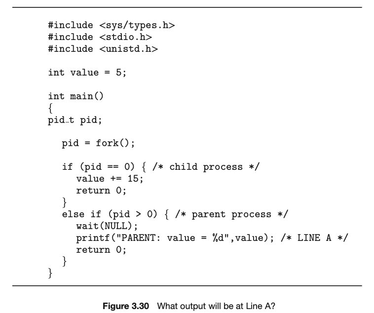
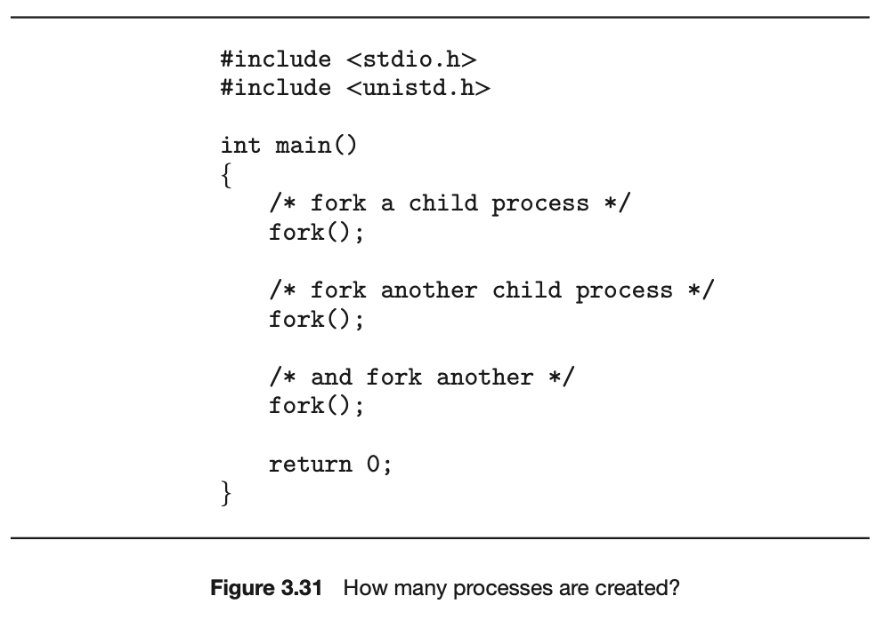
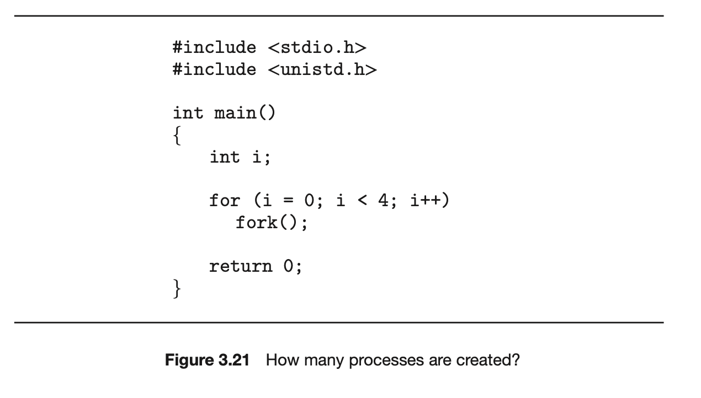
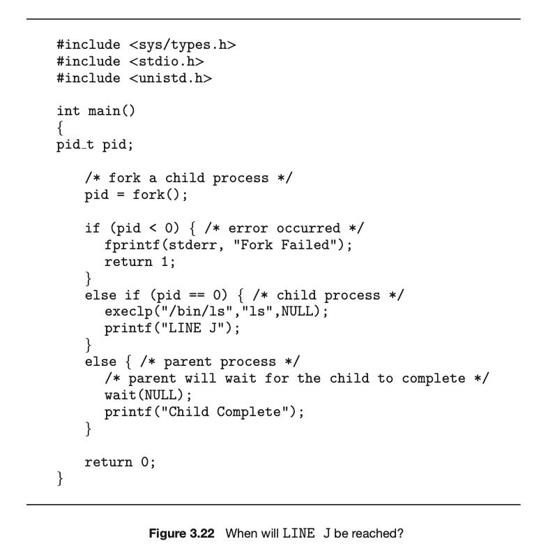

---
tags:
  - CSE330
---
# 3.1 
Using the program shown in Figure 3.30, explain what the output will be at LINE A.

**Answer:** 20

# 3.2
Including the initial parent process, how many processes are created by the program shown in Figure 3.31?

**Answer:** 8

# 3.8
Describe the actions taken by a kernel to context-switch between processes.

**Answer:** The kernel saves the context of the old process in its PCB and load the saved context of the new processes to run. This also require to change the pointer to the new register sets.
# 3.11
Including the initial parent process, how many processes are created by the program shown in Figure 3.32?

**Answer:** 16

# 3.12
Explain the circumstances under which the line of code marked `printf("LINE J")` in Figure 3.33 will be reached.

**Answer:** If the process is the child process after the fork and there is no error. 

